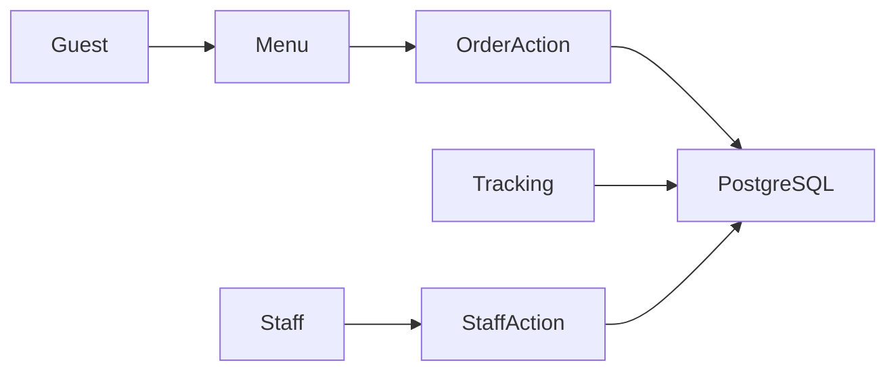
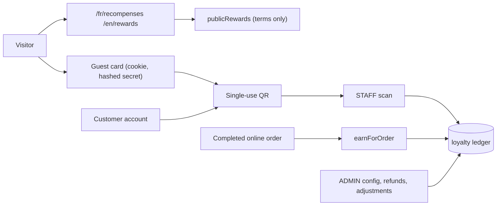

# Architecture

Next.js renders localized routes. The menu client keeps the cart on device and sends validated input to a server action. The order module prices in cents and atomically stores the snapshot and initial event in PostgreSQL. The tracking route queries a minimal projection by random token. The staff page resolves the Better Auth session and current database role before reading the order feed, and order actions repeat the check before changing state. The local demo has a separate signed cookie and is disabled when PostgreSQL is configured.

Tracking and staff refresh every five seconds, and on focus or reconnect. PostgreSQL is authoritative. Polling needs no separate subscription provider, but database reads scale with open tabs. A future notifier should consume persisted outbox events and retry with a dedupe key. Stripe settlement must come from verified webhooks. The loyalty ledger should link awards and reversals to the originating purchase. Design details and DB constraints for those modules remain open.

## Salut Rewards (2026-11-18)

Rewards reuse PostgreSQL as the only store. The ledger (`loyalty_transactions`) is append-only; every change goes through PL/pgSQL functions that lock the account row (`loyalty_post`, `loyalty_redeem`, `loyalty_reverse_refund`, `loyalty_link_guest`). The public pages read only program terms and reward definitions (`publicRewards()`), never accounts. Guests hold a card whose secret is hashed in `loyalty_accounts`.

Details, formulas and states: [Rewards](REWARDS.md). Rewards never alter checkout totals, tax or payment.
